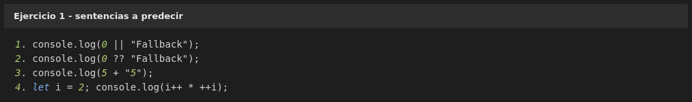
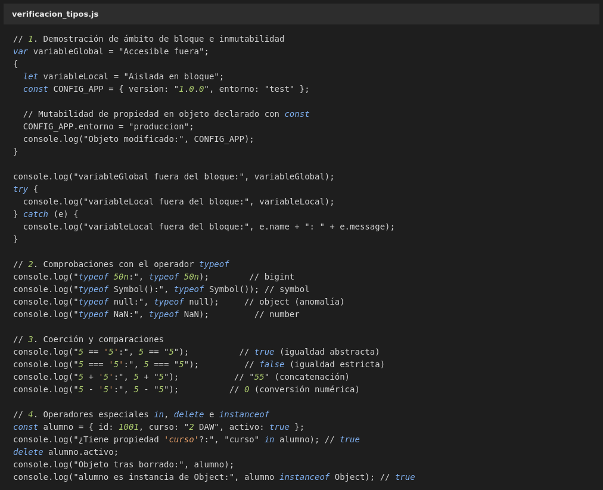
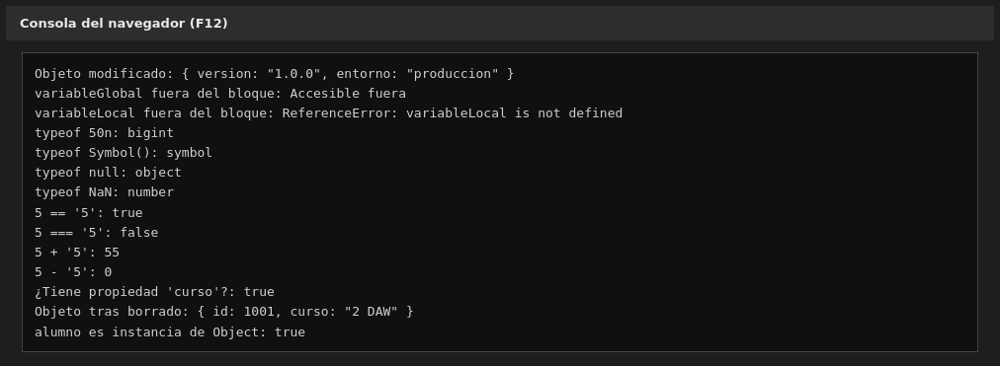
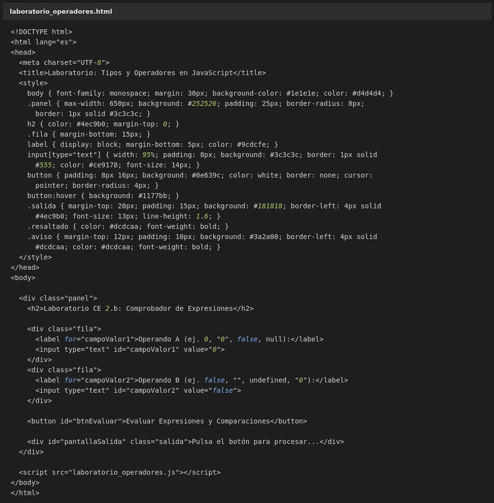
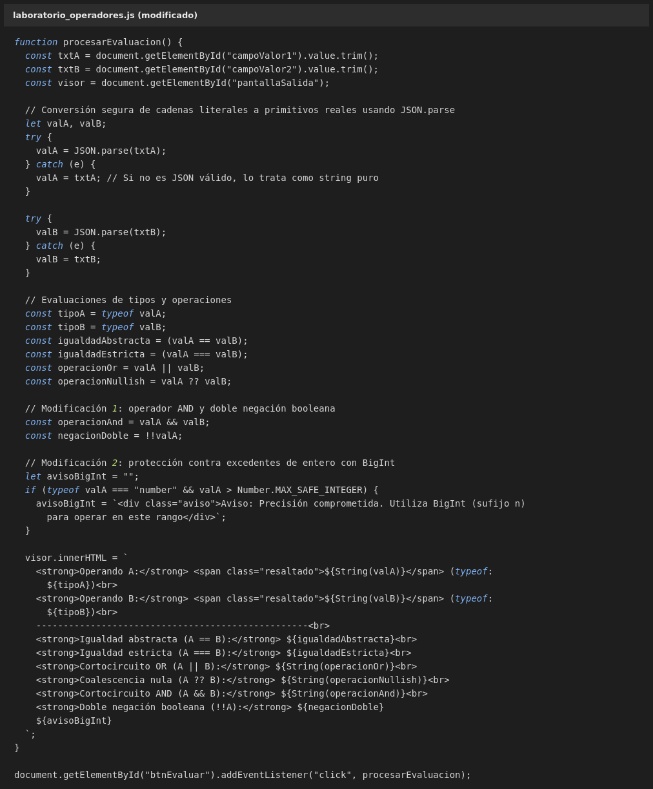
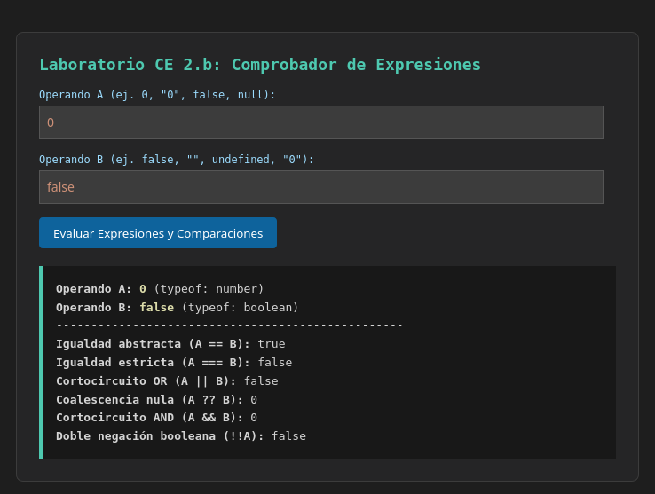
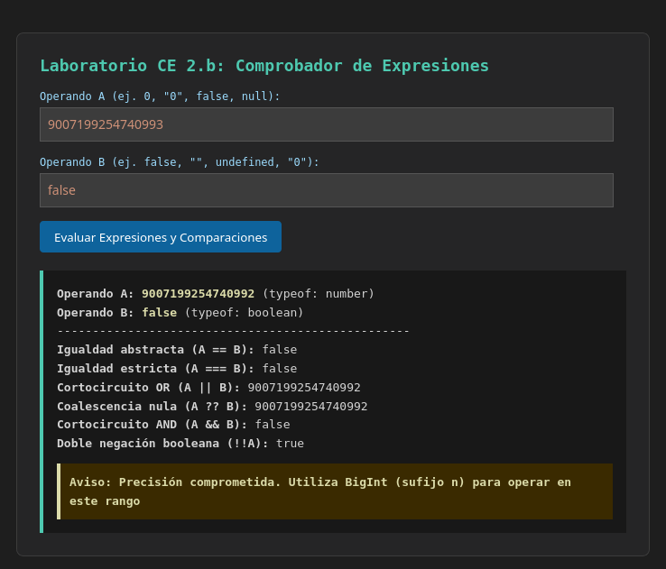
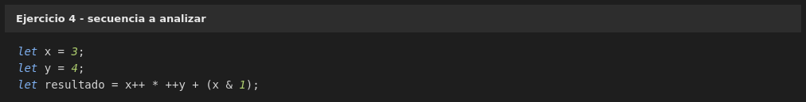
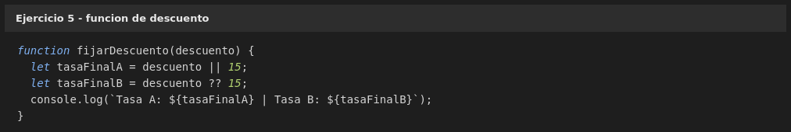

## 1. Predice el valor devuelto por las siguientes sentencias antes de ejecutarlas en la consola de las DevTools (F12):



1. `console.log(0 || "Fallback");` devolverá `Fallback`.

    **Explicación:**
    El operador `||` devuelve el primer operando truthy. Como `0` es un valor falsy en JavaScript, se evalúa el segundo operando.

2. `console.log(0 ?? "Fallback");` devolverá `0`.

    **Explicación:**
    El operador `??` solo devuelve el operando derecho si el izquierdo es `null` o `undefined`. Como `0` no es ninguno de esos, se devuelve `0`.

3. `console.log(5 + "5");` devolverá `"55"` (un string).

    **Explicación:**
    El operador `+` con un número y un string realiza concatenación, no suma aritmética. JavaScript convierte el `5` numérico a string y lo une con `"5"`.

4. `let i = 2; console.log(i++ * ++i);` devolverá `8`

    **Explicación paso a paso:**

    - `i = 2`
    - `i++` → devuelve el valor actual (`2`) y luego incrementa `i` a `3`.
    - `++i` → incrementa `i` de `3` a `4` y devuelve `4`.
    - Multiplicación: `2 * 4 = 8`

<hr>
<hr>

## 2. Ejercicio 2. Verificación exhaustiva de variables y operadores

### - Crea un script llamado `verificacion_tipos.js` y completa el bloque de código para analizar en la consola del navegador los comportamientos de asignación, comprobación y conversión de tipos:



Los huecos que faltaban en cada `console.log` eran estas expresiones:

| Sección | Expresión añadida | Resultado |
| --- | --- | --- |
| 1. Ámbito e inmutabilidad | `CONFIG_APP` | `{ version: "1.0.0", entorno: "produccion" }` |
| 2. `typeof` | `typeof 50n` | `"bigint"` |
| 2. `typeof` | `typeof Symbol()` | `"symbol"` |
| 2. `typeof` | `typeof null` | `"object"` |
| 2. `typeof` | `typeof NaN` | `"number"` |
| 3. Coerción | `5 == "5"` | `true` |
| 3. Coerción | `5 === "5"` | `false` |
| 3. Coerción | `5 + "5"` | `"55"` |
| 3. Coerción | `5 - "5"` | `0` |
| 4. Operadores | `"curso" in alumno` | `true` |
| 4. Operadores | `alumno instanceof Object` | `true` |

Dentro del bloque he añadido también dos comprobaciones para que el apartado de ámbito se vea de verdad: `variableGlobal` se puede leer desde fuera del bloque, pero al intentar leer `variableLocal` desde fuera salta un `ReferenceError`, que es justo lo que demuestra que `let` y `const` tienen ámbito de bloque y `var` no.

Tres resultados merecen un comentario:

- **`typeof null` devuelve `"object"`.** Es una anomalía histórica del lenguaje que se mantiene por compatibilidad: cambiarla ahora rompería muchísimo código antiguo que comprueba tipos de esa forma.
- **`typeof NaN` devuelve `"number"`.** `NaN` (*Not a Number*) no significa "no es un número", sino "el resultado de una operación numérica no es representable"; por eso su tipo sigue siendo `number`.
- **`CONFIG_APP.entorno` cambia sin error aunque el objeto se declare con `const`.** `const` impide reasignar la referencia, no congela el contenido: las propiedades del objeto siguen siendo modificables.

### - Salida en la consola del navegador:



<hr>
<hr>

## 3. Ejercicio 3. Validador de tipos

### - Código base entregado: `laboratorio_operadores.html`



### - `laboratorio_operadores.js` con las dos modificaciones solicitadas:



**Modificación 1 (operador AND y negación booleana).** Se añaden al cálculo las dos expresiones que faltaban y dos líneas nuevas en la salida:

- `valA && valB`, que devuelve `valB` si `valA` es truthy y `valA` si no lo es.
- `!!valA`, que fuerza la conversión a booleano con la doble negación.

**Modificación 2 (protección contra excedentes con BigInt).** Antes de pintar la salida se comprueba `typeof valA === "number" && valA > Number.MAX_SAFE_INTEGER` y, si se cumple, se añade un bloque de aviso con el texto pedido.

### - Funcionamiento con los valores por defecto (A = `0`, B = `false`):



### - Modificación 2 en acción (A = `9007199254740993`):



La captura anterior es la mejor demostración de por qué hace falta la advertencia: se introduce `9007199254740993`, que está por encima de `Number.MAX_SAFE_INTEGER` (`9007199254740991`), y el propio laboratorio lo muestra como `9007199254740992`. El número ya se ha modificado solo al convertirlo a `number`, antes incluso de operar con él. Operando con `9007199254740993n` (sufijo `n`, tipo `bigint`) no se perdería precisión.

<hr>
<hr>

## 4. Ejercicio 4. Análisis de precedencia y operadores unarios combinados

### - Calcula el valor final de `resultado`, `x` e `y` sin ejecutar el código:



**Resultado:**

- `resultado = 15`
- `x = 4`
- `y = 5`

**Paso a paso:**

1. `x++` es post-incremento: devuelve el valor actual, `3`, y después sube `x` a `4`.
2. `++y` es pre-incremento: sube `y` de `4` a `5` y devuelve `5`.
3. La multiplicación se resuelve antes que la suma por precedencia: `3 * 5 = 15`.
4. `(x & 1)` se evalúa **después**, cuando `x` ya vale `4`. El operador `&` compara bit a bit; `4` en binario es `100` y `1` es `001`, así que el resultado es `0`.
5. Suma final: `15 + 0 = 15`.

Lo importante del ejercicio es el orden: los incrementos modifican `x` e `y`, pero el paréntesis `(x & 1)` no se lee hasta después, así que usa el valor ya incrementado de `x`.

<hr>
<hr>

## 5. Ejercicio 5. Comparativa de cortocircuitos con valores falsy críticos

### - Indica qué imprimirá la función si un cliente VIP tiene asignado un descuento legítimo del 0% (`fijarDescuento(0)`):



**Salida:**

```
Tasa A: 15 | Tasa B: 0
```

**Razonamiento:**

- `descuento || 15` con `descuento = 0` evalúa el operando izquierdo como falsy y salta al derecho, así que **`tasaFinalA` acaba valiendo `15`**. El `0%` del cliente se convierte en un `15%`, que es justo lo contrario de lo que se pretendía.
- `descuento ?? 15` solo recurre al valor de la derecha si el izquierdo es `null` o `undefined`. Como `0` no es ninguno de los dos, **`tasaFinalB` se queda en `0`**, respetando el descuento real.

La asignación correcta para el sistema es la segunda (`??`). Un descuento del `0%` es un dato válido y perfectamente intencionado, no una ausencia de dato, y `||` no sabe distinguir esas dos situaciones. El operador `??` se introdujo precisamente para cubrir este caso.

<hr>
<hr>

## 6. Ejercicio tipo test

**1. ¿Qué valor almacena en memoria una variable declarada con `var` si todavía no se le ha asignado ningún dato (`var micoche;`)?**

b) `undefined`.

Una variable declarada y no inicializada recibe automáticamente el valor `undefined`. El caso de `null` es distinto: hay que asignarlo a mano.

**2. Si se evalúa la expresión aritmética `12 + "5"` en JavaScript, ¿qué resultado exacto se obtiene?**

c) `"125"`.

El operador `+` con un operando de tipo string realiza concatenación, así que convierte el `12` a texto y lo une con `"5"`, dando el string `"125"`.

**3. ¿Cuál de los siguientes operadores evalúa si dos operandos son estrictamente idénticos, exigiendo que coincidan tanto en valor como en tipo de datos sin permitir conversiones ocultas?**

c) `===`.

El operador de igualdad estricta no realiza conversiones de tipo, a diferencia de `==`. Un solo `=` es asignación, y `eq` no es un operador de JavaScript.

**4. ¿Qué valor devuelve la instrucción `typeof null` al ejecutarse en el motor del navegador?**

c) `"object"`.

Devuelve `"object"` por un error de la primera implementación del lenguaje que se ha conservado por compatibilidad. No significa que `null` sea un objeto.

**5. ¿Qué operador asigna un valor a una variable única y exclusivamente si dicha variable contiene `null` o `undefined`, respetando valores como `0` o `false`?**

c) `??=`.

El operador de asignación con coalescencia nula solo asigna cuando el valor actual es `null` o `undefined`. Es la versión de asignación del operador `??` visto en el ejercicio 5.

**6. Si una variable declarada con `const` contiene una matriz (`const notas = [5, 8];`), ¿cuál de las siguientes instrucciones es completamente legal y no provocará ningún error?**

b) `notas.push(7);`

`const` impide reasignar la referencia, pero no impide modificar el contenido del array. Por eso `push` funciona, mientras que las opciones `a` y `d` (reasignar) y la `c` (redeclarar con `const`) lanzan un error.
