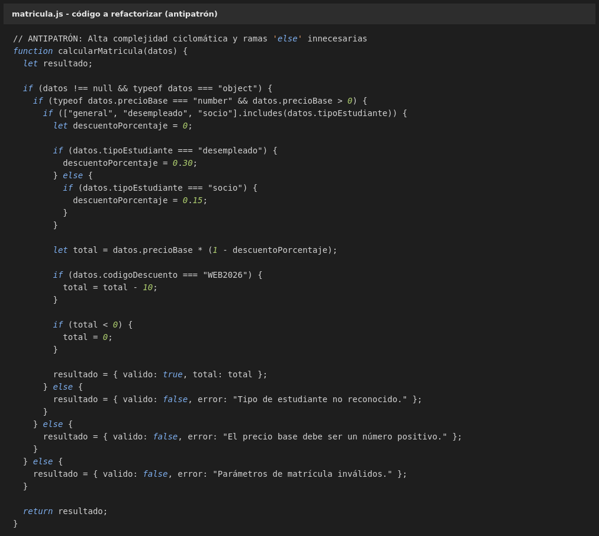
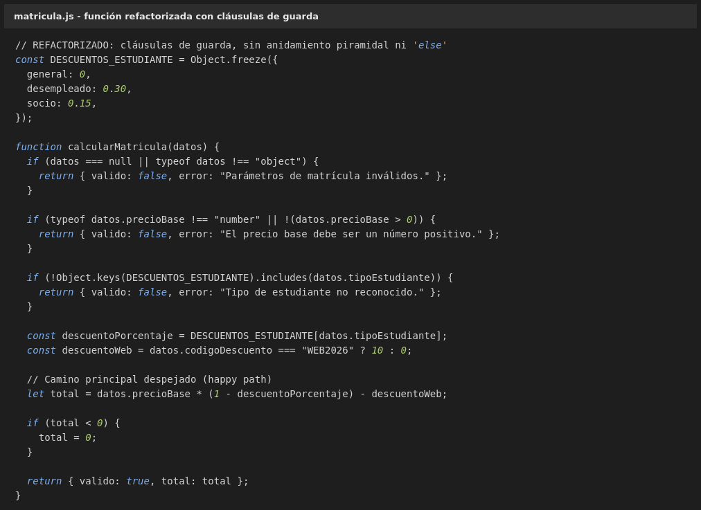
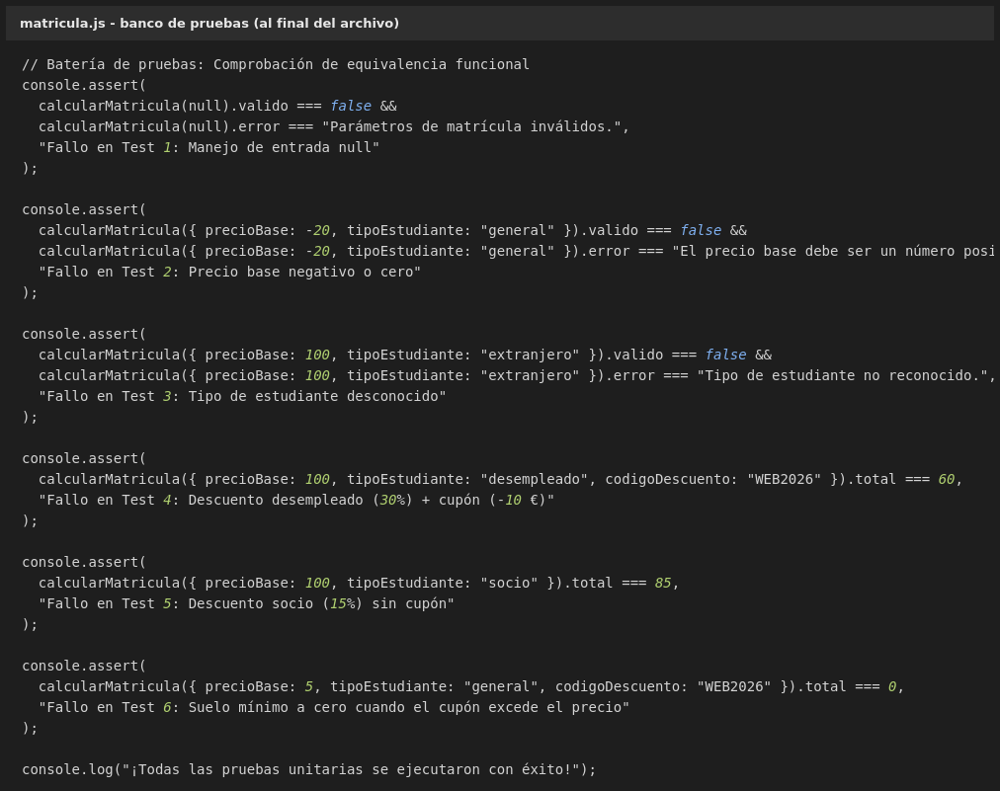

## 1. Ejercicio 1. Refactorización y Control de Complejidad Ciclomática

### - El siguiente fragmento de código ha sido rechazado por el analizador estático. Guarda este código en un archivo llamado `matricula.js`:

> [warning/error] complexity: Function 'calcularMatricula' has a cyclomatic complexity of 8 (max allowed: 5).
>
> [warning] max-depth: Blocks are nested 4 levels deep (max allowed: 2).
>
> [warning] no-else-return: Unnecessary 'else' after 'return'.

### - Reescribir la función `calcularMatricula(datos)` cumpliendo los cinco requisitos:

- **Cláusulas de guarda (guard clauses):** las tres validaciones de precondición van al principio de la función y devuelven con un `return` temprano (`datos` no válido, precio base no numérico o no positivo y tipo de estudiante desconocido), de modo que cuando se llega al cálculo ya se sabe que la entrada es correcta.
- **Sin anidamiento piramidal (arrow anti-pattern):** ningún `if` está dentro de otro `if`. Las guardas son hermanas directas del cuerpo de la función y su `return` es la única instrucción del bloque, así que la indentación máxima dentro de la función es de un nivel.
- **Sin ramas `else` innecesarias:** al cerrar cada `if` con un `return` no queda sitio para un `else`. Las tres guardas usan solo `if`, y las ramas de error ya no se escriben como `else`.
- **Camino principal despejado (happy path):** el descuento por tipo de estudiante, el cupón `WEB2026`, el suelo a cero y el `return` final quedan al final del cuerpo principal, a nivel de la función y sin estar dentro de ningún condicional.
- **Comportamiento idéntico:** se devuelve exactamente los mismos objetos `{ valido: false, error: "..." }` y `{ valido: true, total: ... }` para las mismas entradas.

El porcentaje de descuento se resuelve con una constante `DESCUENTOS_ESTUDIANTE` que ya contiene las tres claves válidas, en lugar de los dos `if` con `else` anidados del original: `Object.keys()` sobre esa misma constante hace de lista de tipos admitidos, así que la validación y el cálculo usan una única fuente y no hace falta repetir la comprobación en dos sitios.

### - Medidas del código refactorizado:

| Medida | Antipatrón | Refactorizado | Límite permitido |
| --- | --- | --- | --- |
| Complejidad ciclomática (`1 + nº de if`) | 1 + 7 = **8** | 1 + 4 = **5** | 5 |
| Ramas `else` | 4 | **0** | 0 |
| `if` anidado dentro de otro condicional | 6 | **0** | — |

### - Añadir el banco de pruebas al final del archivo para verificar la equivalencia funcional:

La salida en la consola del navegador es:

Además de las seis aserciones, se compararon las dos versiones con 24 entradas de todo tipo (`null`, `NaN`, `Infinity`, precios a cero, cupones en minúsculas) y el resultado es idéntico en todas.
